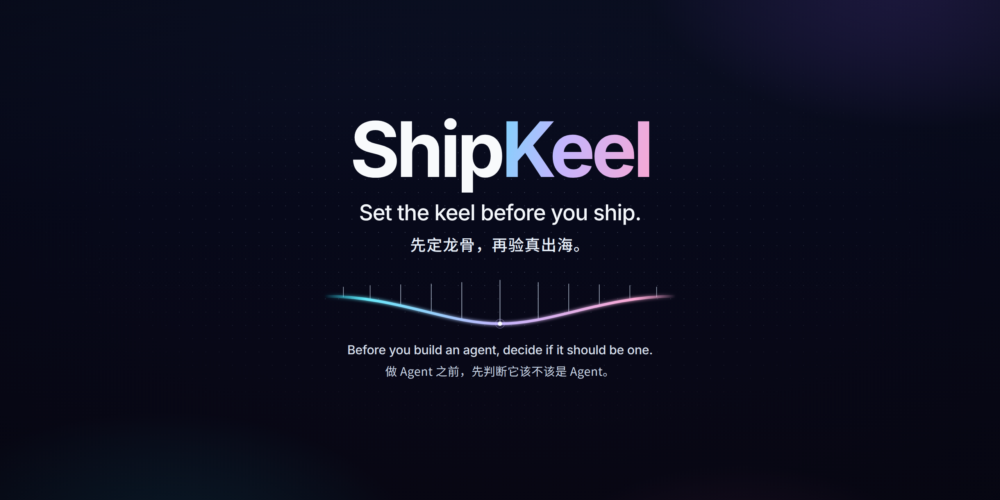

<div align="center">


<br />

# ShipKeel

### **Set the keel before you ship.**

**Before you build an agent, decide if it should be one.**  
Then pick the control-flow level, lock 11 language-agnostic contracts (C1–C11), and copy the starting scaffold for that level.

Design-time: **ShipKeel**. Delivery verification: [**ShipProof**](https://github.com/XingMXTeam/ShipProof).

<p>
  
  
  
  
  
  <a href="https://github.com/XingMXTeam/ShipKeel/actions/workflows/ci.yml"></a>
</p>

**English** | [简体中文](./README.zh-CN.md) · [Decision tree](playbook/README.md) · [Contracts C1–C11](contracts/universal-contracts.md) · [L2 scaffold](scaffolds/plan-execute/README.md) · [ShipProof](https://github.com/XingMXTeam/ShipProof)

</div>

---

## Why start here

Orchestration frameworks are easy to find. What is usually missing is a first decision: should this work be an agent at all, which control-flow level it needs, and how to start on day one with production rules and offline tests.

| | Pick a framework first | Set the keel first |
| :--- | :--- | :--- |
| Opening move | Choose a runtime, then force the business into it | Ask two questions, then pick the lowest level that works |
| Common failure | A one-shot LLM feature is dressed up as an agent; a job that must resume later is stuffed into a one-shot script | [VisualStudio](playbook/cases/visual-studio.md) stays at L0 — it is not an agent, and should not be turned into one |
| Day-one artifact | A shared runtime and a demo | Language-agnostic contracts C1–C11, plus a scaffold you copy into your own repo. You choose the stack. There is no required shared runtime. |
| After design | Hope it holds in production | Verify delivery with [ShipProof](https://github.com/XingMXTeam/ShipProof) |

ShipKeel is a **design-time** engineering template. It is **not** a runtime framework.

---

## Two questions, five levels

Start with only two questions: **Does code or the model decide the next step? If the process dies, must the work resume later?**

Always choose the lowest level that solves the problem.

| Level | Paradigm | Who decides the next step | Real case | Starting scaffold |
|---|---|---|---|---|
| **L0** | Augmented LLM call | Code (one-shot generation) | [VisualStudio](playbook/cases/visual-studio.md) (not an agent; do not make it one) | Docs and a minimal example |
| **L1** | Fixed pipeline | Code or YAML | [Atoms](playbook/cases/atoms.md) · [gop campaigns](playbook/cases/campaign-build.md) | [scaffolds/plan-execute](scaffolds/plan-execute/README.md) (`pipeline` engine). A dedicated `scaffolds/generate-verify-repair/` is **M2, not shipped**. |
| **L2** | Model plans → code executes → code accepts | The model plans once; code runs in parallel | [build campaign setup](playbook/cases/campaign-build.md) | [scaffolds/plan-execute](scaffolds/plan-execute/README.md) (`session` engine) — **shipped** |
| **L3** | Durable state graph + human approval | Graph conditional edges + checkpoints | [finance report parsing](playbook/cases/finance.md) (design case) · future BD agent | `scaffolds/durable-graph/` is **M3, not shipped** |
| **L4** | Autonomous tool loop | The model observes and decides step by step | Future browser / CUA agent | Deferred, until a real project is extracted |

See the [**decision tree**](playbook/README.md), [**pattern blocks**](playbook/patterns.md), and [**framework choices**](playbook/frameworks.md).

---

## 11 universal contracts (C1–C11)

Whatever level you choose, and whether you use TypeScript or Python, production work must meet the same floor. Full rules and deterministic checks: [**contracts/universal-contracts.md**](contracts/universal-contracts.md).

- **C1**: Deterministic values (time, versions, IDs, amounts, formula results) are derived by code. The model does not produce them.
- **C2**: Tool allowlists are enforced in both the prompt and the code.
- **C3**: Plan and execution are separate. The plan passes JSON Schema. Execution is pure code, with no LLM calls.
- **C4**: Pass / fail is decided by deterministic code. The model may explain. It cannot overturn the verdict.
- **C5**: Failures fall back to the safe side. Read-only units throw if asked to write.
- **C6**: There is one write path for source-of-truth data. Extra agents may advise. They do not write.
- **C7**: Repair and rework loops have a turn cap and stop early when there is no progress.
- **C8**: Model access supports `real / mock / replay`. All tests run offline.
- **C9**: Run events and artifacts are written outside the process. Large text, exact numbers, and binaries are passed by key, not by value.
- **C10**: Irreversible writes can require human approval first (required at L3+).
- **C11**: Do not hard-code secrets, internal URLs, or internal identifiers.

---

## Run it locally (offline, no API key)

```bash
npm install
npm run verify          # typecheck + offline unit tests + build + offline E2E smoke + domain list
npm run demo            # starts 3 local mock services and runs the L2 three-stage loop
```

Requires Node.js 20.10 or newer.

---

## What this repository is not

- Not a runtime you must adopt, and not a shared agent platform.
- Not [Atoms](playbook/cases/atoms.md), not [VisualStudio](playbook/cases/visual-studio.md), and not the old “multi-domain harness + dual execution engines” product story.
- Not [ShipProof](https://github.com/XingMXTeam/ShipProof). ShipProof verifies delivery after the keel is set.
- M2, M3, and L4 are not shipped. The finance case is a design write-up. Do not treat `generate-verify-repair` or `durable-graph` as existing scaffolds.

---

## Repository layout

```text
shipkeel/
├── README.md                  # This entry
├── README.zh-CN.md            # Chinese entry
├── AGENTS.md                  # C1–C11 plus the ShipProof protocol
├── playbook/                  # Decision tree, pattern blocks, framework guide, 4 case studies
├── contracts/                 # C1–C11 and deterministic checks
├── scaffolds/
│   └── plan-execute/          # @shipkeel/plan-execute (L2 + L1 reference; single runtime dependency: yaml)
├── .harness/ & .agents/       # ShipProof delivery-verification system and 27 skills
└── package.json               # npm workspaces root
```

---

## Roadmap

- **M1 (current)**: ShipKeel skeleton, `playbook/` decision tree and four case studies, `contracts/` C1–C11, `scaffolds/plan-execute/` workspace, and full-path verification.
- **M2 (not shipped)**: Extract a headless L1 generate-verify-repair scaffold from Atoms (`scaffolds/generate-verify-repair/`).
- **M3 (not shipped)**: Extract the L3 scaffold from the finance design (`scaffolds/durable-graph/`), including checkpointer, interrupt, data-driven metrics, and three-mode offline tests.
- **M4 (not shipped)**: Export C1–C11 as a ShipProof `templates/standards/agent.md` standards pack.

---

## Contributing and license

- [CONTRIBUTING.md](CONTRIBUTING.md)
- [SECURITY.md](SECURITY.md)
- License: [Apache-2.0](LICENSE)

<div align="center">
  <strong>Set the keel first. Then verify delivery with <a href="https://github.com/XingMXTeam/ShipProof">ShipProof</a>.</strong>
</div>
