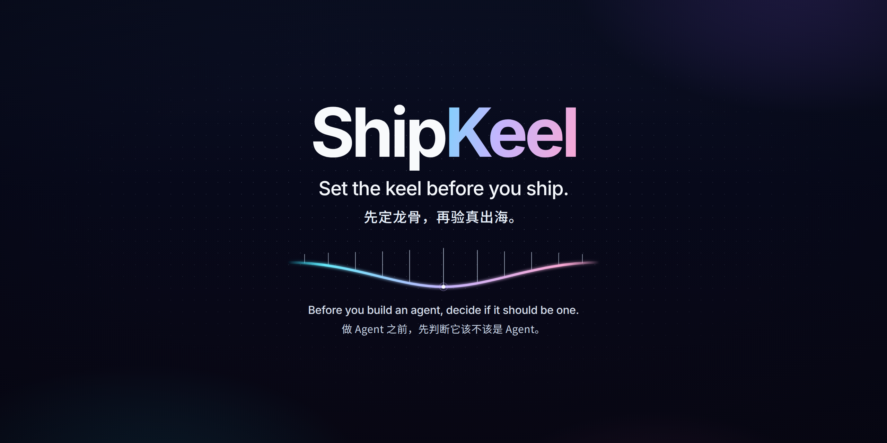

<div align="center">


<br />

# ShipKeel

### **先定龙骨，再验真出海。**

**做任何 Agent 之前，先判断它该不该是 Agent。**  
然后选定控制流级别，对齐 11 条与语言无关的通用契约（C1–C11），再把对应范式的起步脚手架拷进独立业务仓库。

设计期用 **ShipKeel**。交付期用 [**ShipProof**](https://github.com/XingMXTeam/ShipProof) 验真。

<p>
  
  
  
  
  
  <a href="https://github.com/XingMXTeam/ShipKeel/actions/workflows/ci.yml"></a>
</p>

[English](./README.md) | **简体中文** · [选型决策树](playbook/README.md) · [通用契约 C1–C11](contracts/universal-contracts.md) · [L2 脚手架](scaffolds/plan-execute/README.md) · [ShipProof](https://github.com/XingMXTeam/ShipProof)

</div>

---

## 为什么先定龙骨

市面上不缺编排框架。缺的是面对一个新业务时的第一刀：该不该做成 Agent、该选哪一级控制流、以及如何第一天就带上生产纪律和离线测试。

| | 先选框架 | 先定龙骨 |
| :--- | :--- | :--- |
| 第一步 | 先选定运行时，再把业务塞进去 | 先问两个问题，再选能解决问题的最低级别 |
| 常见翻车 | 一次 LLM 调用被包装成 Agent；必须跨时间续跑的活，被塞进一次性脚本 | [VisualStudio](playbook/cases/visual-studio.md) 停在 L0——它不是 Agent，也不该做成 Agent |
| 第一天留下的 | 一套必须共享的运行时，外加一个演示 | 与语言无关的契约 C1–C11，以及拷进独立业务仓库的脚手架。技术栈按场景自选，不强制共享运行时。 |
| 设计之后 | 指望演示能直接进生产 | 用 [ShipProof](https://github.com/XingMXTeam/ShipProof) 做交付验真 |

ShipKeel 是**设计期**的工程母版。它**不是**运行时框架。

---

## 两个问题，五级范式

判断原点只有两个问题：**下一步是代码决定还是模型决定？进程崩了要不要跨时间续跑？**

永远选能解决问题的最低级别。

| 级别 | 范式 | 谁决定下一步 | 真实案例 | 起步脚手架 |
|---|---|---|---|---|
| **L0** | 增强型 LLM 调用 | 代码（单次生成） | [VisualStudio](playbook/cases/visual-studio.md)（不是 Agent，也不该做成 Agent） | 文档 + 极简示例 |
| **L1** | 固定流水线 | 代码 / YAML | [Atoms](playbook/cases/atoms.md) · [gop 投放](playbook/cases/campaign-build.md) | [scaffolds/plan-execute](scaffolds/plan-execute/README.md)（`pipeline` 引擎）。专用的 `scaffolds/generate-verify-repair/` 是 **M2，未交付**。 |
| **L2** | 模型出计划 → 代码执行 → 代码验收 | 模型规划一次，代码并发执行 | [build 活动搭建](playbook/cases/campaign-build.md) | [scaffolds/plan-execute](scaffolds/plan-execute/README.md)（`session` 引擎）——**已交付** |
| **L3** | 持久状态图 + 人工审批 | 图的条件边 + Checkpoint | [finance 财报解析](playbook/cases/finance.md)（设计稿）· 未来 BD Agent | `scaffolds/durable-graph/` 是 **M3，未交付** |
| **L4** | 自主工具循环 | 模型逐步观察并决策 | 未来浏览器手操 / CUA Agent | 暂缓，待真实项目抽取 |

详见 [**选型决策树**](playbook/README.md)、[**模式积木**](playbook/patterns.md) 与 [**框架与 SDK 选型**](playbook/frameworks.md)。

---

## 11 条通用契约（C1–C11）

无论选哪一级范式、用 TypeScript 还是 Python，进入生产必须对齐同一份底线。完整细则与确定性检查见 [**contracts/universal-contracts.md**](contracts/universal-contracts.md)。

- **C1**：确定性的值（时间、版本、ID、金额、公式结果）由代码推导，模型不产出
- **C2**：工具白名单在提示侧与代码侧双重约束
- **C3**：计划与执行分离（计划过 JSON Schema，执行是不含 LLM 调用的纯代码）
- **C4**：验收 pass / fail 由确定性代码判定，模型只解释，不能改判
- **C5**：失败往安全侧兜底；只读单元显式抛错拒绝写入
- **C6**：真值只有一条写入路径；额外 Agent 只献智不动手（只读输出结构化提议）
- **C7**：修复与返工循环必有轮次上限与无进展早停
- **C8**：模型接入支持 `real / mock / replay` 三模式；测试全部离线
- **C9**：运行事件与产物外置落盘；大文本 / 精确数值 / 二进制传键不传值
- **C10**：不可逆写操作前可插入人工审批点（L3+ 必选）
- **C11**：严禁硬编码密钥、内网地址与内部标识

---

## 快速验证（全部离线，无需 API Key）

```bash
npm install
npm run verify          # typecheck + 离线单测 + 构建 + 离线 E2E 冒烟 + 域列表
npm run demo            # 启动本地 3 个 mock 服务，演示 L2 三阶段闭环
```

需要 Node.js 20.10 或更高版本。

---

## 这不是什么

- 不是必须接入的运行时，也不是一套要共享的 Agent 平台。
- 不是 [Atoms](playbook/cases/atoms.md)，不是 [VisualStudio](playbook/cases/visual-studio.md)，也不是旧的「多域 Harness + 双执行引擎」产品叙事。
- 不是 [ShipProof](https://github.com/XingMXTeam/ShipProof)。龙骨定完之后，交付验真交给 ShipProof。
- M2、M3、L4 尚未交付。finance 仍是设计稿。不要把 `generate-verify-repair` 或 `durable-graph` 写成已有脚手架。

---

## 目录结构

```text
shipkeel/
├── README.md                  # 英文入口
├── README.zh-CN.md            # 中文入口
├── AGENTS.md                  # 通用契约 C1–C11 + ShipProof 协议
├── playbook/                  # 五级范式决策树、模式积木、框架选型与 4 份案例拆解
├── contracts/                 # 通用契约 C1–C11 与确定性检查细则
├── scaffolds/
│   └── plan-execute/          # @shipkeel/plan-execute（L2 + L1 参考实现，运行时只依赖 yaml）
├── .harness/ & .agents/       # ShipProof 交付验真体系与 27 份 Skills
└── package.json               # npm workspaces 根配置
```

---

## 演进路线

- **M1（当前）**：ShipKeel 骨架、`playbook/` 决策树与 4 份案例拆解、`contracts/` C1–C11、`scaffolds/plan-execute/` workspace 迁移与全链路验真。
- **M2（未交付）**：从 Atoms 抽取无界面 L1「生成-验证-修复」脚手架（`scaffolds/generate-verify-repair/`）。
- **M3（未交付）**：从 finance 设计稿抽取 L3 脚手架（`scaffolds/durable-graph/`），补齐 Checkpointer、Interrupt、口径数据化与三模式离线测试。
- **M4（未交付）**：将 C1–C11 导出为 ShipProof 的 `templates/standards/agent.md` 规范包。

---

## 贡献与协议

- 贡献说明见 [CONTRIBUTING.md](CONTRIBUTING.md)
- 安全策略见 [SECURITY.md](SECURITY.md)
- License: [Apache-2.0](LICENSE)

<div align="center">
  <strong>先定龙骨，再用 <a href="https://github.com/XingMXTeam/ShipProof">ShipProof</a> 验真出海。</strong>
</div>
